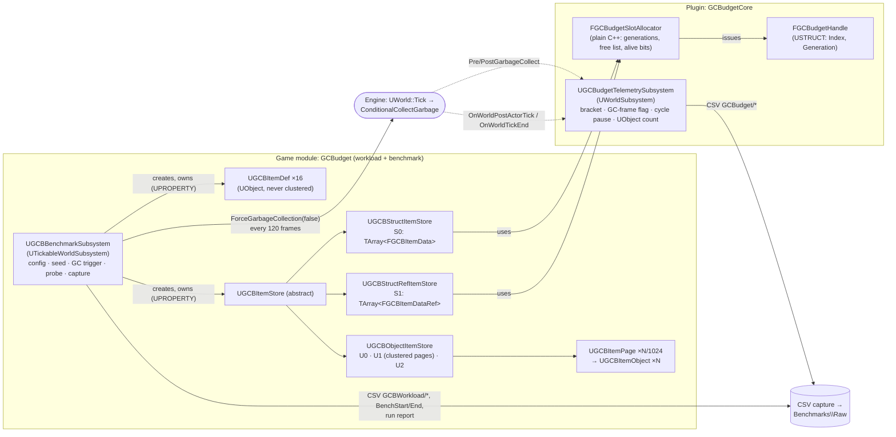
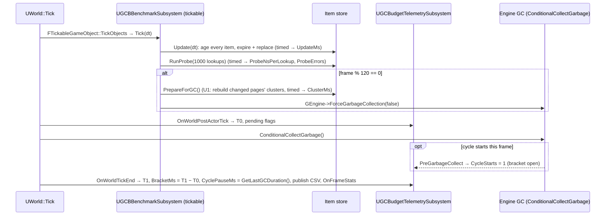

# 02 · System Architecture: GCBudget (v1.1)

**Phase:** 3 (Architecture), **final**, 2026-11-21. The only earlier plan was the one-row summary in the README; §13 lists what changed from it.
**Revised:** 2026-11-21 in Phase 5 step S1, where the code and its review proved three details wrong; §14 lists them.
**Engine:** UE 5.8.4. Every engine behaviour relied on here is verified in [01b_Research_Findings.md](01b_Research_Findings.md); references like `01b #3` point to its §1 table.
**Rule:** this is the design *before* code. If implementation proves a decision wrong, this file is updated in the same step.

---

## 1. Goals and non-goals

**Goals**
1. **Measure** what each data design costs the garbage collector, per cycle and per frame, at 0 to 100,000 items, on one deterministic workload.
2. Provide a **reusable GC telemetry** component: per-frame GC time, per-cycle pause, live UObject count. A project drops it in and sees the same numbers this study uses.
3. Provide **generational handles** for struct-array storage. The array stays a normal `UPROPERTY`, and stale handles are detected instead of reading the wrong item.
4. Switch between all six configurations (E0, U0, U1, U2, S1, S0) **in the same build**, with identical simulated work (checked by a checksum).
5. Keep the plugin free of any knowledge of the workload, and keep its handle logic **testable without a world**.

**Non-goals (v1)**
- An inventory, buff or item *system*. The item model is a minimal workload (`01` §6.1).
- Replacing Mass (that is P9), or comparing against it.
- Multithreaded item updates (incremental reachability is not thread-safe, `01b` #8).
- Replication or save games for the stores (growth paths, §11).
- Changing engine code (launcher build).

## 2. The core idea in plain words

The GC pays for **UObjects** (each is scanned, and traversed while reachable) and for **references** (each is followed). It pays nothing for a struct field that is a plain number (`01b` #4–5).

So the design moves hot, numerous gameplay data out of UObjects into a `UPROPERTY() TArray<FItem>` whose elements hold **no** object pointers. Shared data that must stay a UObject (definitions, assets) is referenced **by index** into a small table that GC sees only once.

Code outside the store refers to an item through a **handle**:

```text
FGCBudgetHandle = { Index, Generation }
Resolve(h)      = (Generations[h.Index] == h.Generation && Alive[h.Index]) ? h.Index : INDEX_NONE
Release(index)  → Generations[index] += 1   // every outstanding handle to that slot is now stale
```

This is the same shape as the engine's own `FWeakObjectPtr` (index + serial number) and `FMassEntityHandle` (`01b` #15). We copy it on purpose, and we measure it against `TWeakObjectPtr`.

Everything else in the project exists to **measure** the effect fairly against the engine's own options.

## 3. Modules and where they live

```text
D:\UNREAL PORTFOLIO\P04_GCBudget\GCBudget\                    ← the UE project (Phase 4)
├── GCBudget.uproject
├── Source\GCBudget\{Public,Private}\                          ← game module: workload, stores, benchmark director
├── Plugins\GCBudgetCore\Source\GCBudgetCore\{Public,Private}\ ← the reusable toolkit
└── Config\
D:\UNREAL PORTFOLIO\P04_GCBudget\Tools\                        ← build/package/smoke scripts; Python stats + runner
```

| Module | Type | Responsibility | Depends on |
|---|---|---|---|
| `GCBudgetCore` (plugin) | Runtime | GC telemetry, generational handles and slot allocator | `Core`, `CoreUObject`, `Engine` |
| `GCBudget` (primary game module) | Game | Item definitions, the six configurations' stores, the benchmark director | `GCBudgetCore` |
| `Tools\` | Python, batch | Build, package, smoke; CSV statistics; the interleaved, P-core-pinned runner | — |

**The dependency rule:** game → plugin, never the reverse. Module names are unique per project (`research/04` §0), hence `GCBudgetCore` vs `GCBudget`.

## 4. Classes

### 4.1 Plugin `GCBudgetCore` (3 pieces)

| Class | Kind / base | Responsibility | Why it exists, and what we rejected |
|---|---|---|---|
| `FGCBudgetHandle` | `USTRUCT(BlueprintType)`: `int32 Index = INDEX_NONE`, `int32 Generation = 0` | A stable, copyable reference to an item in a struct store. `IsSet()`, `==`, `GetTypeHash` | A USTRUCT so it can live in `UPROPERTY`s and pass through Blueprint as an opaque value. `int32` fields, not `uint32`, because Blueprint has no unsigned 32-bit type. *Rejected:* raw indices (silently read a reused slot); pointers into the array (dangle on reallocation) |
| `FGCBudgetSlotAllocator` | Plain C++ class (no UObject, no reflection): `TArray<int32> Generations`, `TArray<int32> FreeSlots` (LIFO), `TBitArray<> Alive`, `int32 NumAlive` | Hands out slot indices with generations: `Allocate()`, `Release(Handle)`, `Resolve(Handle)`, `IsSlotAlive(Index)`, `Num()`, `NumSlots()`, `Reset()` | **The owner keeps the data** in its own `UPROPERTY() TArray<FItem>`, indexed by slot. Reflection, GC visibility (for S1's references) and Blueprint access stay correct by construction. The allocator holds only integers, so it is unit-testable without a world. *Rejected:* a template container `TGCBudgetArray<T>` that owns the data (templates can't be `UPROPERTY`; S1's references would need a hand-written `AddReferencedObjects`); a dense array with an indirection table (an extra lookup per access for no benefit when expired slots are refilled at once, §7) |
| `UGCBudgetTelemetrySubsystem` | `UWorldSubsystem`, Game and PIE worlds only | Per frame: timestamps `FWorldDelegates::OnWorldPostActorTick` and `OnWorldTickEnd` for **its** world (the bracket around `ConditionalCollectGarbage`, `01b` #14); flags GC frames (a cycle started via `PreGarbageCollect` **while its bracket was open**, or incremental reachability, unhash or purge was pending when the bracket opened); counts cycles that start outside the bracket separately; reads `GetLastGCDuration()` when the bracket closes, because the engine stores it only after `PostGarbageCollect` (§14); reads the live UObject count. Publishes CSV stats once per frame and a native `OnFrameStats` delegate | A world subsystem has exactly the world's lifetime and needs no actor in a map. Delegates rather than a tick, because the bracket must sit *around* the engine's GC call. *Rejected:* a custom `UGameEngine` subclass (the GC call isn't virtual, `01b` #14; only its start could be hooked); the engine's CSV GC column alone (partial, `01b` #14); `UE::GC::Private::FStats` (not exported); an engine subsystem (no world tick to bracket) |

**Telemetry CSV stats** (category `GCBudget`, enabled by default, one value per frame):

| Stat | Meaning |
|---|---|
| `BracketMs` | Time from `OnWorldPostActorTick` to `OnWorldTickEnd` |
| `GCFrame` | 1 if GC work could run in this frame (see above), else 0 |
| `CycleStarts` | Number of GC cycles that started in this frame (0 or 1) |
| `CyclePauseMs` | `GetLastGCDuration()` × 1000 on a cycle-start frame, else 0 |
| `UObjects` | `GUObjectArray.GetObjectArrayNumMinusAvailable()` at the end of the frame |

**Console variable:** `gcb.Telemetry` (`ECVF_Default`; 1 on, 0 off). The analysis thresholds (5 ms spike, 33.3 ms hitch) live in the Python statistics, not in the game, so changing them never needs a rebuild.

### 4.2 Game module `GCBudget` (8 types)

| Type | Base | Responsibility |
|---|---|---|
| `UGCBItemDef` | `UObject` | One of 16 shared definitions: `Decay`, `BaseMagnitude`. `CanBeInCluster()` returns **false**, so definitions never join a page's cluster. Otherwise the first page to cluster would absorb them, every other page would reference that cluster, and rebuilding it would dissolve them all (cluster rules, `01b` #10) |
| `UGCBItemObject` | `UObject` | U0/U1/U2 item: `TObjectPtr<UGCBItemDef> Def`, `TimeLeft`, `Magnitude`, `Charges`, `Serial`. `CanBeInCluster()` returns **true** (Epic's recipe, `Phase2_Raw_Notes/D` §D2) |
| `UGCBItemPage` | `UObject` | Holds up to 1,024 items: `UPROPERTY() TArray<TObjectPtr<UGCBItemObject>>`. The cluster root in U1. Used in U0 and U2 too, so U1 differs **only** by clustering |
| `FGCBItemData` | `USTRUCT` | S0 element: `DefIndex`, `TimeLeft`, `Magnitude`, `Charges`, `Serial`. No object references, so nothing in the GC schema (`01b` #5) |
| `FGCBItemDataRef` | `USTRUCT` | S1 element: the same with `TObjectPtr<UGCBItemDef> Def` instead of `DefIndex`. One reference per element |
| `UGCBItemStore` | abstract `UObject` | The store interface the director calls: `Populate`, `Update(Dt)`, `RunProbe`, `Checksum`, `PrepareForGC` (no-op except U1) |
| `UGCBObjectItemStore` / `UGCBStructItemStore` / `UGCBStructRefItemStore` | `UGCBItemStore` | U0/U1/U2 (`bClusterPages` for U1); S0; S1. The two struct stores share one private implementation template over the element type, so their logic cannot drift apart |
| `UGCBBenchmarkSubsystem` | `UTickableWorldSubsystem`, Game and PIE | The director. Reads `-GCB…=` values; applies GC cvars from code and restores each one in `Deinitialize`; creates the definitions and the store; per frame updates the store, runs the probe, owns the GC trigger, publishes workload CSV stats and the capture events; writes the run report; requests exit. A subsystem rather than an actor, because the project has no authored map (the same reason P01 gave, verified there) |

**Command line** (all optional; defaults in §7): `-GCBConfig=U0|U1|U2|S1|S0`, `-GCBItems=`, `-GCBSeed=`, `-GCBGCFrames=`, `-GCBWarmup=`, `-GCBCapture=`, `-GCBProbe=`, `-GCBRunTag=` (the run report's name, written to `Saved/GCBRuns/`), `-GCBExit` (quit once the report is written).

**Workload CSV stats** (category `GCBWorkload`): `Items`, `Expired`, `UpdateMs`, `UpdateNsPerItem`, `ProbeNsPerLookup`, `ProbeErrors`, `ClusterMs` (U1 only), `GCTrigger` (1 on the frame the director requests a cycle).

## 5. Overview diagram



## 6. Per-frame flow



**Order matters, and it is verified:** the director ticks inside `FTickableGameObject::TickObjects` (`LevelTick.cpp:1821`), before the GC call (`:1970`) in the same `UWorld::Tick`. U1's cluster rebuild therefore always lands in the frame the cycle starts, and is charged to that frame.

### The GC trigger, in plain words

The director sets the engine's own timer out of the way (`gc.TimeBetweenPurgingPendingKillObjects = 3600`) and calls `GEngine->ForceGarbageCollection(false)` every 120 frames.
- That call only moves the timer past the interval (`UnrealEngine.cpp:2136–2139`).
- The cycle then starts inside `ConditionalCollectGarbage` through exactly the same branch as a timer-driven GC (`:2284–2287`): a non-full purge with incremental purge, and incremental reachability when enabled.
- If the previous cycle's purge is still running, the engine waits for it (`:2282`), and so does the cycle.

*Why not keep the engine timer at 2 s?* The timer field is private (`Engine/Classes/Engine/Engine.h:2006–2012`). U1 must rebuild clusters in the frame *before* a cycle, and only the code that triggers the cycle knows which frame that is. One trigger for all configurations keeps them identical.

### Item update, in code-sized pseudocode (every store runs the same math)

```text
for each live item i (lane order):
    i.TimeLeft  -= dt
    i.Magnitude *= 1 − Decay(i.Def) · dt            // Decay read through the definition, as gameplay code would
    if i.TimeLeft ≤ 0:
        Expired += 1
        UObject stores: i.MarkAsGarbage(); page.Items[slot] = NewItem(lane)   // old object → garbage
        Struct stores:  Release(slot); Allocate() → same slot (LIFO); Items[slot] = NewItem(lane)
NewItem(lane) = parameters from Hash(Seed, lane, laneGeneration)   // order-independent, identical in every store
```

**Why per-lane hashing instead of one random stream:** the stores visit items in the same lane order, but expiry and replacement must not depend on store internals. A pure function of (seed, lane, generation) makes every configuration simulate bit-identical work. The checksum (SC7) proves it.

## 7. Defaults and why

| Setting | Default | Reasoning |
|---|---|---|
| GC cadence | 120 frames (2.0 s at a 60 Hz fixed step) | About 30 cycles per 60 s capture: stable p95 and max (`01` §6.1). The default 61.1 s gives one cycle a minute |
| Engine GC timer | 3600 s | Parks the timer; the director triggers cycles (§6) |
| Items per page (U0/U1/U2) | 1,024 | Well above `gc.MinGCClusterSize` (5, `BaseEngine.ini:1753`), so every page forms a cluster; 98 pages at 100k. One expiry dirties one page (about 1% of the clusters), not the whole store as a single cluster would. **Honest caveat:** at 1% churn per second each page sees about 20 expiries per 2 s cycle, so U1 rebuilds nearly every cluster before every cycle. That maintenance cost is exactly what U1 is there to show (H4). A page-size sweep is a Phase 8 option |
| U2 time limit | 2 ms | Epic's 5.8 docs example. The 5.8.4 default is 5 ms (`GarbageCollection.cpp:310`), a third of a 60 fps frame |
| Lifetimes | uniform [50, 150] s | Mean 100 s gives 1% churn per second: real garbage every cycle, and N stays constant |
| Probe | 1,000 lookups per frame from a pool of 4,096 references | Enough lookups for a stable ns figure, small next to the update loop. Some references expire, so stale-handle detection is exercised every frame |
| Handle generation | starts at 1; 0 is "never valid" | A default-constructed handle is always stale. Wrap-around after 2³¹ releases of one slot is documented (§12) |
| Free list | LIFO | An expired slot is refilled in the same frame, so the array stays dense and the hottest memory is reused |
| Warm-up / capture | 10 s / 60 s | At least four cycles after population before measuring; then about 30 cycles |
| Spike / hitch thresholds | 5 ms / 33.3 ms (analysis only) | 5 ms is 5.8.4's own default incremental slice; 33.3 ms is two 60 Hz frames |

## 8. Lifetime and safety rules

| Risk | Rule | Evidence |
|---|---|---|
| An object reference GC can't see | Every UObject reference is a `UPROPERTY() TObjectPtr<>`. The stores and definitions are `UPROPERTY` members of the director, which is owned by the world | `01b` #9 |
| Incremental reachability misses a write | `TObjectPtr` only, so the write barrier fires. No raw `UObject*` members anywhere | `01b` #9; docs (D1) |
| Item access off the game thread | None. Every store operation runs in the director's game-thread tick (incremental GC is not thread-safe) | `01b` #8 |
| Cluster edits racing the GC | U1 creates and dissolves clusters only in the director's tick, never inside GC delegates, and is never combined with U2 | `01b` #10 |
| A clustered item kept alive after expiry | Expiry calls `MarkAsGarbage()` and drops the pointer. `PrepareForGC` dissolves and rebuilds the clusters of changed pages before each cycle, so dead items are no longer clustered when the GC looks | `01b` #10 |
| A handle to a reused slot | `Resolve` compares generations. Every access goes through `Resolve`; raw indices are never stored across frames | §2 |
| A pointer into a struct array after it grows | The stores `Reserve(N)` at populate and never grow during a run; code never keeps element pointers across `Allocate` | `TArray` reallocation semantics |
| A parked GC timer leaking into the next world | Every cvar the director sets goes through one function that records the previous value; `Deinitialize` restores them all | §14 |
| Telemetry outliving its world | Delegates are bound in `Initialize` and removed in `Deinitialize`; every callback checks that its world is the one ticking | §4.1 |
| A hidden full purge | Nothing in the project calls `CollectGarbage()` or `ForceGarbageCollection(true)` (both full purges) | `01b` #2 |

## 9. One workload for every configuration

| Config | Store | GC settings applied by the director |
|---|---|---|
| E0 | Any store with `-GCBItems=0` | Defaults + director trigger |
| U0 | `UGCBObjectItemStore` | Defaults + director trigger |
| U1 | `UGCBObjectItemStore` with `bClusterPages` | Defaults + director trigger (`gc.CreateGCClusters` stays 1) |
| U2 | `UGCBObjectItemStore` | `gc.AllowIncrementalReachability 1`, `gc.IncrementalReachabilityTimeLimit 0.002` |
| S1 | `UGCBStructRefItemStore` | Defaults + director trigger |
| S0 | `UGCBStructItemStore` | Defaults + director trigger |

All values are set with `IConsoleVariable::Set(…, ECVF_SetByCode)`, logged, and written into the CSV metadata, so every capture states its own configuration. `-NoVerifyGC` is on the command line of every timed run (`01b` #11).

## 10. C++ vs Blueprint

| C++ | Blueprint |
|---|---|
| Everything that is measured: the stores, the update and probe loops, the telemetry, the director | `FGCBudgetHandle` is `BlueprintType`, so it can be stored and passed in Blueprint. A small function library (`IsValid`, `Resolve` through an owning store) is a Phase 10 option, with its VM cost measured, not assumed. Nothing in the benchmark runs in Blueprint |

## 11. How it grows into a production game (not built now)

- **Replication:** struct stores map naturally onto `FFastArraySerializer` items, the way GAS replicates active effects (`01b` #15). The handle's generation doubles as an item version.
- **Save games:** struct elements serialize as plain data; handles are rebuilt on load from stable item ids.
- **Polymorphic items:** keep a UObject only for items that need per-instance behaviour (UFUNCTIONs, Blueprint subclasses), and point to it from the struct by handle or soft reference. The migration guide (Phase 10) gives the decision table.
- **Memory attribution:** an LLM tag `GCBudget` around store allocations (`LLM_DEFINE_TAG`, `01b` §2).
- **CI guard:** the telemetry's CSV columns can feed a performance gate (the portfolio's UE5-TestTrust project), failing a build whose GC pause regresses.
- **Lint:** a data-validation rule that flags `UObject`-per-item patterns in hot containers (the portfolio's UE5-GameplayLint project).
- **Millions of entities:** at that scale, Mass is the engine's answer (the portfolio's UE5-StateHandoff project). This toolkit targets ordinary gameplay code that is not written for Mass.

## 12. Known limits (stated, not hidden)

1. **The bracket is an estimate of GC time:** it contains a small non-GC remainder, removed by subtracting the run's own floor. Phase 5 validates it against the Insights `ConditionalCollectGarbage` timer and reports the difference.
2. **Development GC carries Epic's pointer checks** (about 20% by Epic's comment) and can't be measured without them on a launcher engine (`01b` #12).
3. **A 2 s cadence is a stress cadence** (`01` §8).
4. **U1 measures one reasonable clustering design** (pages + rebuild before each cycle), not every possible one.
5. **U2 is Experimental and not fully thread-safe.** It is measured, not recommended.
6. **Handle generations wrap** after 2³¹ releases of one slot. A stale handle could then match. In a 60 s run at 1% churn a slot is released about once, so this is far outside the test, but the limit is real for long sessions.
7. **Struct items give up per-item UObject features** (`01` §8).
8. **Single world.** In PIE with several worlds, only the world whose tick runs the GC sees it in its bracket. Packaged runs have one game world.
9. **No bracket while paused.** `OnWorldPostActorTick` fires only when actors tick: not when the world is paused or ticks time only (`Engine/Private/LevelTick.cpp:1650–1656, 1898–1907`). The telemetry then publishes no bracket for that frame (it never invents one). Benchmark runs never pause.

## 13. Changes from the README plan

| Change | Why |
|---|---|
| Added **S1** (structs that still hold a reference) | Separates objects from references; the production case where object count fell but GC time rose (`01b` §6) |
| Added **E0** (no items) | SC1 needs the engine's own floor in this project |
| Pages for all UObject configurations | U1 must differ from U0 only by clustering |
| Director owns the GC trigger | The engine timer is private, and U1 needs to know the frame before each cycle (§6) |
| Telemetry brackets the GC call instead of reading engine stats | The engine's CSV column is partial and `FStats` is not exported (`01b` #14) |
| `-NoVerifyGC` everywhere | Development verifies GC by default and distorts clustering most (`01b` #11) |
| U2 at 2 ms, not the 5 ms default | Epic's documented example; fits a 60 fps frame (`01b` #6) |
| "Novel technique" → "measured study + toolkit" | The pattern is in the engine already (`01b` #15–16) |
| Per-item access cost reported in ns, not µs | The expected scale (`01b` §2) |

## 14. Changes made during implementation

| Step | Change | Why |
|---|---|---|
| S1 | The cycle pause is read when the bracket closes (`OnWorldTickEnd`), not in `PostGarbageCollect` | The engine stores `GetLastGCDuration()` after that delegate fires, so a handler there sees the previous cycle (`07` §3) |
| S1 | A cycle counts for a frame only if it starts while that world's bracket is open; others are counted separately and reported | `PreGarbageCollect` is global. A cycle during map load or another world's tick would otherwise be charged to the next frame (found in review, `09`) |
| S1 | The director restores every console variable it changed | A world that outlives the benchmark (PIE, map travel) would otherwise keep a parked GC timer (found in review, `09`) |
| S1 | `-GCBReport=` became `-GCBRunTag=` plus `-GCBExit` | The runner needs a known report name per run and a clean exit, not a folder choice |
