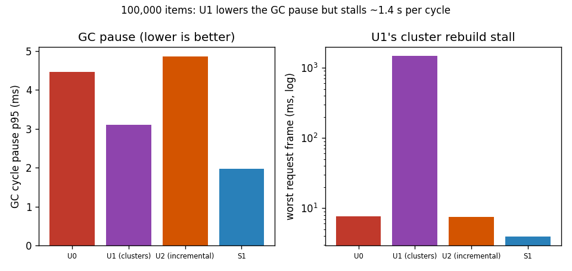
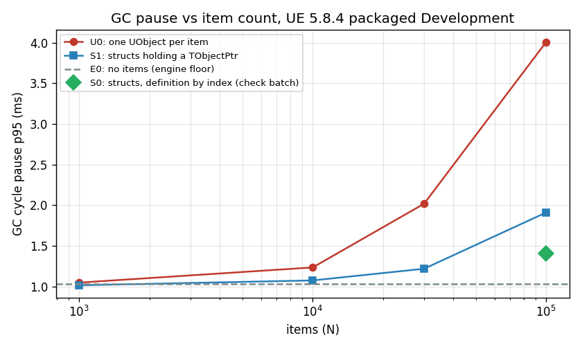

# P04 · GCBudget: garbage-collection-aware gameplay data

**Author:** Krish Gangani · [github.com/KrishGangani](https://github.com/KrishGangani)

**Domain:** Memory & resource optimisation · UObject lifecycle · **Difficulty:** ★★★½☆ · **Engine:** UE 5.8.4

> **Status: complete (by the owner's direction, without the final protocol batches).** The results below come from the recorded baseline and check batches (`Explanation/09`); anything not measured says so.

| Phase | 1 Problem | 2 Research | 3 Architecture | 4 Foundation | 5 Implementation | 6 Explanation | 7 Testing | 8 Profiling | 9 Review | 10 Portfolio |
|---|---|---|---|---|---|---|---|---|---|---|
| State | ✓ | ✓ | ✓ final | ✓ | ✓ (S1–S7) | ✓ | ✓ (tests only) | — | — | — |

---

## Problem statement

Gameplay designs often make every small, numerous thing a UObject: each timed effect, each inventory entry, each payload. The garbage collector pays for every live UObject (each one is scanned, and traversed while reachable) and for every reference it follows. A design that is fine at 1,000 items can turn every GC cycle into a visible frame spike at 100,000.

UE 5.8 added an Insights trace counter, "UObject Count", to watch the number. Tom Looman's 5.8 notes say object count "directly affects garbage collection performance". The counter shows the count; it doesn't show the cost, or what to do about it.

Details: [Explanation/01_Problem_Analysis.md](Explanation/01_Problem_Analysis.md).

## Engineering approach

1. **Measure** GC cost against item count and data design on one deterministic workload, in packaged builds:
   - the per-cycle pause;
   - the per-frame GC time and hitches;
   - the UObject count and resident memory;
   - the per-item access cost.
2. **Compare five designs:**
   - one UObject per item (U0);
   - the same with GC clusters (U1);
   - the same with incremental reachability, which is **Experimental** and not fully thread-safe (U2);
   - a struct array that still holds one reference per item (S1);
   - a struct array with no object references, addressed by **generational handles** (S0).
3. **Package the reusable parts** as a small plugin, `GCBudgetCore`:
   - GC telemetry (per-frame GC time, per-cycle pause, live UObject count, as CSV stats);
   - an (index, generation) handle and slot allocator for struct storage.

**What is not new, stated plainly:** keeping high-count state in struct arrays with generational handles is a pattern Epic already uses (`FWeakObjectPtr`, Mass entities, GAS active effects). This project claims no new technique. Its contribution is the **controlled measurement** and a small toolkit. Phase 2 found no public, reproducible 5.8 comparison of these designs on one workload; Epic's own published numbers are single data points.

Details: [Explanation/01b_Research_Findings.md](Explanation/01b_Research_Findings.md) (what the 5.8.4 source shows) and [Explanation/02_System_Architecture.md](Explanation/02_System_Architecture.md) (the design).

## Architecture diagram

Final (v1.0): [Explanation/02_System_Architecture.md](Explanation/02_System_Architecture.md) §5–6 (mermaid diagrams: modules and per-frame flow).

## Main Unreal Engine technologies

UObject/GC internals (reachability, gather, purge, clusters, the disregard-for-GC pool), `TObjectPtr` and its write barrier, `USTRUCT` arrays and the GC schema, generational handles, `gc.*` console variables, the CSV profiler, Unreal Insights (the 5.8 "UObject Count" counter), LLM tags, `obj list`.

## Success criteria (targets, defined before implementation)

Judged at 100,000 items; 10,000 is always reported beside it. The full table is in [01_Problem_Analysis.md §6.4](Explanation/01_Problem_Analysis.md).
- **GC pause** (p95/max) flat with item count for S0, and lower worst-frame GC time than the best of U0, U1 and U2.
- **GC-caused spikes and hitches** per minute no higher than an empty level.
- **UObject count:** S0 adds no more than 32 objects.
- **Resident MB:** S0 uses at most half of U0's bytes per item.
- **Per-item access cost** (ns): S0 no worse than U0, so the trade-off is visible.
- **0 stale-handle errors**, and identical simulated work in every configuration (checksum).

## Existing work it is compared against

- Epic's incremental GC documentation (Experimental; "not fully thread safe").
- Epic's "Garbage Collector Internals" knowledge-base article: one measured example, the runtime clustering recipe, and the Development verification caveat.
- An Epic forum case of a production server with Epic staff replies: clustering "only moves the time cost"; incremental GC not recommended in 5.5/5.6.
- GC clustering, the `TObjectPtr` write barrier, and the 5.8 "UObject Count" trace counter, each verified in the 5.8.4 source.

**The gap it targets:** measured GC-cost-vs-design curves on one controlled workload, with the trade-offs shown together. **Gap strength (re-checked in Phase 2):** medium for the measurement, weak for the technique.

**Main risk:** turning into a "basic inventory". The item model is a deliberately minimal workload; the subject is object-count and reference-count scaling.

## Before / after comparison

At 100,000 items, packaged Development, fixed 60 Hz step, P-cores pinned. Cycle-pause p95 is the median across runs.

| Configuration | GC pause p95 | UObjects | Update ns/item | Lookup ns | Worst request frame |
|---|---|---|---|---|---|
| U0: one UObject per item | 4.46 ms | 136,723 | 10.1 | 40.7 | 7.6 ms |
| U1: U0 + a GC cluster per page | 3.10 ms | 136,728 | 10.0 | 39.8 | **≈ 1,474 ms** (cluster rebuild) |
| U2: U0 + incremental reachability (2 ms) | 4.86 ms | 136,742 | 10.0 | 40.7 | 7.5 ms |
| S1: structs, each holding a `TObjectPtr` | 1.98 ms | 35,534 | 2.6 | 32.0 | 3.9 ms |
| **S0: structs, definition by index** | **1.41 ms** | **35,537** | 2.9 | 33.0 | — |
| E0: no items | 1.92 ms* | 35,536 | — | — | — |

U rows and S1 come from Batch A (`2026-11-21_063108_s6batchA`: 60 s captures, 4 runs). S0 and E0 come from the S7 check batch (`2026-11-21_082841_s7check`: 20 s captures, 2 runs, so indicative). \*With 10 cycles per capture, E0's p95 is set by occasional slow cycles (about 2.6–2.9 ms, cause unverified). Its 60 s value is 1.03 ms (Batch B).

**Headline:** U1's clustering lowers the GC pause but stalls the game thread about **1.4 s per cycle** at 100k, because every page changes between cycles and must be rebuilt. S0 keeps the GC pause at the engine's own floor with one extra UObject, whatever N is.



## Benchmark results



- **The pause grows with object count** (U0: about 1.0 ms at 1k to 4.0 ms at 100k, Batch B). S1, which keeps one reference per element but almost no UObjects, grows far less (1.9 ms at 100k). S0 at 100k (1.41 ms) sits at the E0 floor.
- **Correctness:** every configuration computes the same work. The end-of-run checksums are identical across U0, U1, U2, S1 and S0, and the lookup probe made 0 errors in every run.
- **The measurement is validated:** per cycle, our GC bracket matches Insights' `ConditionalCollectGarbage` timer within 0.008 ms.
- **Success criteria:** SC1–SC4, SC6 and SC7 met (SC1 and SC2 indicative); SC5 (memory) not measured; SC8 (the full curve with ≥ 3 runs) not met. Full table: [09](Explanation/09_Testing_And_Benchmarks.md#results-the-success-criteria).
- **Not run** (by the owner's direction): Phase 8's balanced matrix, the Insights drill-downs, the Shipping cross-check, long runs.

Raw data: [Benchmarks/](Benchmarks/README.md) (manifests and summaries in git; raw captures are attached to the GitHub release).

## Recorded demonstration

Not recorded (by the owner's direction).

## Why studios care

- Memory management appears in 18 of 57 job postings reviewed.
- EA NHL: "taking ownership of memory management, multi-threading, and frame-rate optimization".
- Ubisoft Snowdrop: "memory usage and loading times".
- GC is among the hitch categories in Epic's "Great Hitch Hunt" coverage.

Sources: [Explanation/Research/01_job_market.md](Explanation/Research/01_job_market.md), [02_technical_challenges.md](Explanation/Research/02_technical_challenges.md).

## Method

Every project in the portfolio follows the same ten phases: problem analysis → research → architecture → foundation → implementation → explanation → testing → profiling → review → portfolio. Each phase is documented in `Explanation/` (files 00–12, including a line-by-line code walkthrough). Every claimed improvement must be measured against the existing solutions above on the same workload. Engine: Unreal Engine 5.8.4, C++.

## Source code

The UE project is in [GCBudget/](GCBudget/) (UE 5.8.4, C++):
- the reusable system is the plugin `GCBudgetCore`;
- the workload, the stores for each configuration and the benchmark director are in the game module `GCBudget`.

Build, package and smoke scripts are in [Tools/](Tools/). Every Unreal job on this machine runs through a shared job queue, so measurements stay clean.

## Documentation

| File | Contents |
|---|---|
| [00_Project_Overview](Explanation/00_Project_Overview.md) | Identity, demonstration, presentation, industry relevance |
| [01_Problem_Analysis](Explanation/01_Problem_Analysis.md) | Problem, existing work, hypotheses H1–H8, workload, configurations, metrics, success criteria, measurement plan |
| [01b_Research_Findings](Explanation/01b_Research_Findings.md) | Phase 2: how the 5.8.4 GC actually works (verified in source), the README claims checked, and what changed in the design |
| [02_System_Architecture](Explanation/02_System_Architecture.md) | Final v1.0: modules, classes, data flow, per-frame flow, safety rules, rejected alternatives |
| [03_Implementation_Roadmap](Explanation/03_Implementation_Roadmap.md) | The small, ordered build steps; baselines captured before the proposed store exists |
| [04](Explanation/04_CPP_Fundamentals.md) · [05](Explanation/05_Line_By_Line_Code_Explanation.md) · [06](Explanation/06_Unreal_APIs_And_Macros.md) · [07](Explanation/07_Common_Mistakes.md) | Fundamentals, line-by-line code, APIs and macros, common mistakes. Current to the end of Phase 5; consolidated and re-checked in Phase 6 |
| [09](Explanation/09_Testing_And_Benchmarks.md) | Every check so far, with its exact command and result |
| [08](Explanation/08_Debugging_And_Profiling.md) | Debugging and profiling: the project's instruments, the CSV profiler, Insights, GC commands and logs, each checked in the engine source |
| [10](Explanation/10_Interview_Questions.md) · [11](Explanation/11_Optimization_Decisions.md) · [12](Explanation/12_Future_Scalability.md) | Interview questions; optimisation decisions (none made: no Phase 8); future scalability |
| [Phase2_Raw_Notes/](Explanation/Phase2_Raw_Notes/README.md) | The audit trail behind `01b`: every quote and source line |
| [Research/](Explanation/Research/) | The portfolio-wide research this project draws on |

## Folder layout

```text
P04_GCBudget\
├── README.md        ← this page (becomes the project's portfolio page)
├── Explanation\     ← 00–12, raw research notes, portfolio research
├── Benchmarks\      ← Raw\ (local; manifests in git) + Summaries\
├── Media\           ← diagrams, screenshots, demo video
├── Tools\           ← build, package, smoke scripts; CPU pinning; statistics, runner, batch checks, bracket validation
└── GCBudget\        ← the Unreal Engine project
```

## License

MIT, see [LICENSE](LICENSE). Unreal Engine itself is not included and is covered by Epic Games' own license.
